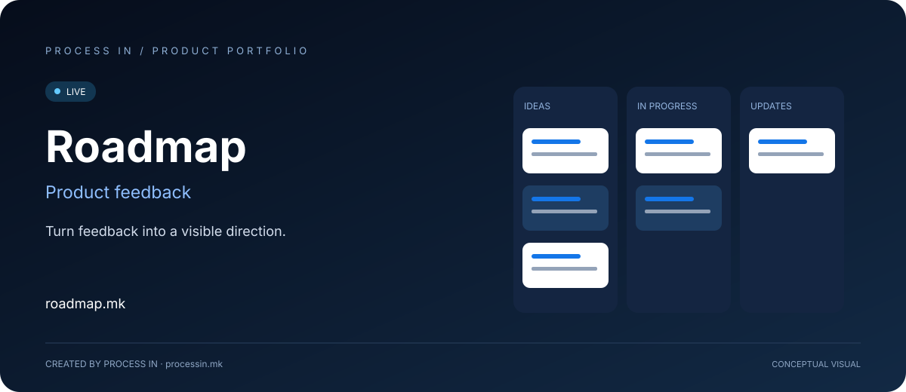

# Roadmap

**Turn feedback into a visible direction.**

[English](README.md) · [Македонски](README.mk.md)

**LIVE** · Confirmed by the owner

## The product

Roadmap gives product teams a place to collect customer ideas, prioritize requests and communicate product direction. Feedback boards, roadmaps and changelogs keep the conversation connected.

## How to get started

| Step | Action |
|---|---|
| 01 | Collect ideas |
| 02 | Discuss and assess requests |
| 03 | Prioritize upcoming work |
| 04 | Share the roadmap and release updates |

## Core capabilities

| Area | What it offers |
|---|---|
| **Feedback boards** | Collect customer ideas. |
| **Voting** | Surface supported requests. |
| **Comments** | Discuss feedback. |
| **Prioritization** | Compare benefit and cost scores. |
| **Roadmaps** | Share public or private direction. |
| **Changelog** | Announce product changes. |

## Who it is for

Product managers and software teams managing customer feedback.

## Practical scenario

Bring recurring customer requests together before deciding which improvements to communicate next.

## Product experience

The illustration above presents the product's purpose conceptually. Visit the official website for the current interface, available options and terms.

## Product information

| Detail | Value |
|---|---|
| Website | [roadmap.mk](https://roadmap.mk/) |
| Category | Product feedback |
| Status | LIVE |
| Developer | [PROCESS IN](https://processin.mk) |
| Portfolio contact | [contact@processin.mk](mailto:contact@processin.mk) |

Presentation sources: [1](https://roadmap.mk/).

### [Visit Roadmap](https://roadmap.mk/)

[PROCESS IN — Your Enterprise Software & AI Partner](https://processin.mk)

---

Public product showcase. No proprietary application code, customer data or production secrets are included. This presentation does not grant an open-source license to the product.
